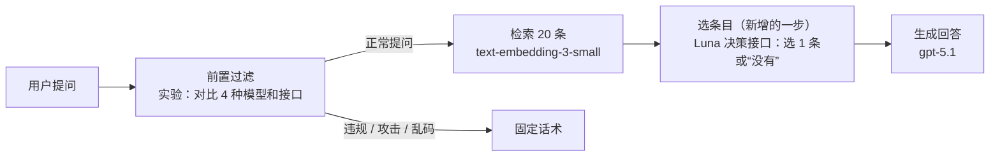

最近接触到一个新名词：Decision Model，决策模型。它的用法很直观：给模型一些上下文和几个候选项，让它返回结果以及各个选项的概率。业务代码再据此决定下一步。看到这里，我的第一反应是：这不就是LLM已经会做的事情吗？只需要在写提示词的时候加一句“只返回指定选项以及它们的概率”这样的限定条件，模型就会返回类似的结果了。既然如此，为什么还需要一个专门的模型，或者专门的接口？

带着这个问题，我进行了一些调查，也在一个demo中做了简单的试用。在这篇文章里我会分享我的调查结果和试用体验，并尝试回答这个问题。

## 1. 软件有时只需要一个判断

对于日常使用聊天产品，或者代码生成产品的用户来说，模型输出一段文本或者一段代码往往很有帮助，但在另一些场景里，系统只需要一个有限的判断：

- 这条工单属于哪个部门？
- 搜索结果是否与用户的提问相关？
- Agent应该调用哪个工具来完成任务？
- 这段回答是否存在需要复核的问题？
- ...

这些任务当然可以交给普通LLM。[Structured Outputs](https://developers.openai.com/api/docs/guides/structured-outputs) 还能约束模型的输出符合指定的 JSON Schema，所以“返回结构化结果”并不是决策模型独有的能力。

既然普通 LLM 已经能完成这些任务，决策模型到底改变了什么？是判断能力更强，还是完成同一个判断的方式更高效？要回答这个问题，先看看它实际接收什么、返回什么。

## 2. 决策模型是什么，与LLM有什么区别，怎么用？

简单来说，**决策模型是专门用来做判断的模型。** 应用先给出一段上下文和预先定义好的问题（某个条件是否成立、在几个选项里选哪一个、按几个有序等级打几分），它返回的不是一段文字，而是对应类型的结果，以及各个选项的概率，程序可以直接拿它决定下一步。

和对话模型最直观的区别在输出：对话模型输出的是开放的文本，决策模型的输出被限定在应用事先给出的范围里，并且附带概率。

“决策模型”目前更像是一类产品的统称，而不是一种统一的技术。不同方案的底层实现并不一致，有的基于已有语言模型的后训练，有的提供专门的决策接口，也有方案会根据问题难度追加推理。因此，不能仅凭“返回决策”就判断它采用了全新的架构，也不能笼统地说这类模型都不推理。

从应用开发的角度，可以先区分三种用法：

| 用法 | 应用定义什么 | 得到什么 |
|:---|:---|:---|
| 普通 LLM 加提示词 | 任务和回答要求 | 生成的文本，例如一个部门名称 |
| LLM 加 Structured Outputs | 任务和 JSON Schema | 符合指定结构的生成结果 |
| 决策接口 | 上下文、问题、候选项或评分等级 | 指定类型的决策值，以及接口提供的概率信息 |

它们能完成的任务有很大交集，选用哪一种需要看具体应用场景中的质量、延迟、成本和部署要求。

专门优化的空间在于：当系统需要反复做这类判断时，能否减少每次调用的耗时和费用，并直接获得可供程序使用的选项概率。这也是 [Jev](https://typesafe.ai/blog/introducing-system-one-models-and-jev)、[Microsoft-Decision-1](https://commandline.microsoft.com/microsoft-decision-1-model-foundry/) 等产品强调的方向：把分类、路由、评分等判断做成软件里的基础操作。具体能带来多少收益，还需要在实际任务中比较。

不过，让 LLM 在回答中写下“这个选项的概率是 90%”，与直接读取模型的选项分数，并不是同一回事。前者仍是模型生成的文本，后者来自具体决策实现的评分过程。但接口返回了概率，也不代表这个数字已经可靠；无论采用哪种方式，想据此自动执行操作，都需要先在自己的数据上验证。

### 一个最小调用示例

以 OpenAI 的 Decisions API 为例，它提供三种问题类型：

- `predicate`：判断条件是否成立，返回为真的概率
- `choice`：从候选项中选择，返回选择结果以及各个选项的概率
- `score`：根据有序等级评分，返回等级索引的概率加权平均值，可以落在两个等级之间

我后面的小实验只用到 `choice`，所以这里拿它举例。场景是：用户问了一个问题，检索已经给出了几条候选的问答，我想让模型直接告诉我哪一条回答了这个问题。向 `POST /v1/decisions` 发送这样的请求：

```json
{
  "model": "gpt-6-luna",
  "input": "営業部のリモートワーク制度について教えてください",
  "questions": [
    {
      "type": "choice",
      "name": "pick",
      "instructions": "Pick the entry that directly answers the user's question. If none does, pick none.",
      "choices": [
        { "value": "q012", "description": "Q: リモートワークはできますか A: 会社全体では週2日まで可能です。" },
        { "value": "q047", "description": "Q: 営業部のリモートワークは A: 営業部は週1日まで可能です。" },
        { "value": "q051", "description": "Q: 開発部のリモートワークは A: 開発部は週3日まで可能です。" },
        { "value": "none", "description": "No entry directly answers the user's question." }
      ]
    }
  ]
}
```

实际的请求里有 20 条候选，这里只留了 3 条。返回的结构大概是这样的（**数字是我为了演示填的，不是真实调用结果**）：

```json
{
  "answers": [
    {
      "type": "choice",
      "name": "pick",
      "choice": "q047",
      "probabilities": [
        { "value": "q012", "probability": 0.03 },
        { "value": "q047", "probability": 0.94 },
        { "value": "q051", "probability": 0.01 },
        { "value": "none", "probability": 0.02 }
      ],
      "confidence": 0.9
    }
  ]
}
```

程序只需要读 `choice`：是 `none` 就走“确认不了”的兜底回复，否则把对应的那一条交给后面的回答模型。

> 这里有两点需要留意。
>
> **1.** `none` 是我自己加的选项，接口不会替你加。
>
> **2.** `confidence` 是接口单独返回的一个字段，官方没有说明它是怎么算出来的，不要把它当成答对的概率。想拿它设阈值之前，最好先用自己的数据测试一下。
{: .prompt-tip}

目前该接口支持 `gpt-6-luna`，一次最多带 400 个提问。未缓存输入的价格是每百万token $0.10，输出不收费；缓存、区域处理和长上下文另有计费规则。[参考：Decisions 官方指南](https://developers.openai.com/api/docs/guides/decisions)

### 它是否必须是一种全新的模型？

不一定。《[Releasing the Inner Jev](https://arxiv.org/abs/2610.17205)》展示了一种方法：给现有开源 LLM 提供选项标签，直接读取最后位置的选项 logits，得到概率，而不生成完整文本。作者在其采用的基准上报告了与 Jev 可比的结果。这说明，直接做决策可以是已有 LLM 的一种使用方式。专用训练和推理优化仍然可能有价值，但“决策模型”这个名称本身并不能证明它拥有通用 LLM 无法实现的能力。

## 3. 决策模型发展的时间线

这里不展开分类器和机器学习的完整历史，只看和这轮产品化有关的几个节点：

| 时间 | 事件 |
|:---|:---|
| 2026-09-15 | TypeSafe 发布 **Jev** 早期访问版本，提出 System One Models 的产品定位。[官方介绍](https://typesafe.ai/blog/introducing-system-one-models-and-jev) |
| 2026-09-30 | Fastino 发布 **GLiDE**，官方介绍强调它会在不确定时追加推理。[官方介绍](https://fastino.ai/blog/introducing-glide-the-first-thinking-decision-model) |
| 2026-10-01 | Cloudflare 发布 **Clef** 和 **Clef-flash**。[官方介绍](https://blog.cloudflare.com/clef-decision-models) |
| 2026-10-06 | **OpenAI Decisions API** 进入公测。[更新日志](https://developers.openai.com/api/docs/changelog) |
| 2026-10-09 | 微软发布 **Microsoft-Decision-1**。[官方介绍](https://commandline.microsoft.com/microsoft-decision-1-model-foundry/) |
| 2026-10-22 | **OpenAI Decisions API** 正式可用。[更新日志](https://developers.openai.com/api/docs/changelog) |

从这张表能看出来，决策模型不是某一家公司的单点产品。从 Jev 开始算，到 OpenAI 正式可用，前后只隔了五周多，期间好几家公司各自推出了自己的版本。除了表里的几家，Perplexity 的 [Decider](https://docs.perplexity.ai/docs/decisions/quickstart)、Liquid 的 [d1 系列](https://docs.liquid.ai/lfm/models/decision-models)也有类似的产品。

为什么这些产品最近集中出现？我的理解是，随着 LLM 更多地参与软件内部流程，分类、路由、评分这类判断也开始被频繁调用。对于这些任务，程序往往只需要一个结果，生成一段文字的灵活性未必有用，延迟和费用却需要承担。决策模型尝试专门优化这些调用，再把它们作为独立产品或接口提供出来。新出现的主要是这轮产品化，而不是“让模型做选择”的能力本身。

## 4. 我在 RAG 中做了一次简单试用

我仿照在工作中维护的问答系统，在本地搭建了一个简化版Demo，它的流程大致是这样：用户提出问题，这个问题进入系统后首先会经过一步过滤，将违规、攻击和乱码的提问提前挡掉（guardrail）。这一步通过后，系统根据该问题的向量相似度从自己的数据库里检索出20条相近的问答，再把它们交给 LLM，让它参考并生成回答。我想试两件事：

- **在检索和生成之间加一步“决策”：** 先挑出最贴切的那一条，或者判断“这 20 条都不是”，再交给生成模型。
- **把前置过滤换成决策接口：** 它本来就是一次独立的模型调用，正好可以直接替换。



### 数据和设置

真实业务数据不能拿来使用，所以我和 LLM 探讨并设计了一个虚构的日语招聘问答库，一共有153条数据。每个话题的“形状”是用固定随机种子掷出来的，大致分为以下几种：

- 只存在一种公司内部统一的说法
- 在公司内部统一说法之外还存在几个部门的具体规定
- 有些部门规定和公司统一说法存在冲突
- 同一种说法有多种别称
- 同一种说法存在不同时间线上的不同版本

“选对”的规则：

- 问题点名了某个部门，库里也有这个部门的条目，选那一条
- 问题没点名部门，选公司统一的那一条
- 问题点名了某个部门，但库里没有这个部门的条目，选公司统一的那条，或者老实说“没有”，都算对；选到别的不相关部门，算错
- 库里压根没有这个话题，只有选择“没有”才算对

每个环节用的模型如下：

| 环节 | 用的模型 |
|:---|:---|
| 前置过滤 | 对比四种做法：gpt-4o-mini、gpt-5.1、`gpt-6-luna` 的对话接口，以及 `gpt-6-luna` 的决策接口 |
| 检索 | `text-embedding-3-small`，按向量相似度取前 20 条 |
| 选条目 | 对比四种做法：向量第一名（不调用模型）、`gpt-6-luna` 的对话接口、gpt-5.1，以及 `gpt-6-luna` 的决策接口 |
| 生成回答 | gpt-5.1，默认设置，没有指定推理参数 |
| 给回答打分 | gpt-5.1 |

测试时使用了120个问题，其中包含使用日常口语的、带错别字的、啰嗦的、点名某个部门的，也有库中根本没有答案的。检索时每条问答把“提问 + 答案”连在一起进行计算，取最相近的20条，不设阈值。这一步本身质量不差：设定了标准答案的107个问题里，正确条目100%在前20条之内，88%排第一。所以后续的实验中选错的几乎不是检索的锅。

### 选条目：同样是 Luna，决策接口选得快得多

我对比了4种做法：

| 做法 | 选对（120 题） | 响应时间 P50 / P95 | 120 次调用费用 |
|:---|---:|---:|---:|
| 向量检索的第一名 | 94（78%） | — | — |
| Luna 的普通对话接口，要求返回条目编号 | 118（98%） | 1330 / 1861 ms | $0.023 |
| gpt-5.1 读完 20 条后选一条 | 118（98%） | 1141 / 1602 ms | $0.298 |
| Luna 的决策接口，20 条作为候选项，再加一个 `none` | 117（98%） | 238 / 411 ms | $0.023 |

这里我特意加入了 Luna 的对话接口作为对照：它和决策接口用的是同一个模型标识 `gpt-6-luna`。使用相同模型标识，可以减少直接比较不同模型带来的干扰。不过，公开文档不足以证明两种接口的底层计算和服务配置完全相同，所以这里比较的是两种调用方式的实际表现。

先说正确率。除了“永远选相似度第一名”的做法，另外三种都在98%左右，决策接口少选对1题，在这个规模下没法说谁更准确，只能说都已经接近上限。向量第一名的78%倒是值得一看，它错的26题中有13题是库中本来就没有答案的，而它永远会硬选一条，这也体现了在检索后多一道判断的意义。

再看耗时和费用。决策接口的中位耗时是238ms，对话接口则是1330ms，决策接口大约快了5.6倍。两个 Luna 接口120次调用的花费几乎一样，都是0.023美元左右（费用按官方价格表和实际token数估算，两者输入价格都是每百万token 0.10美元）；gpt-5.1 读20条要0.298美元，约贵13倍，主要是它的单价高。

从这个实验结果来看，在选条目这个单项任务上，决策接口的正确率和通用模型相当，响应时间却明显更短。

### 总耗时：选择变快了，用户却没有更早看到答案

单个环节最终还是在一整个系统里发挥作用，所以还需要看其对于整个系统的影响。在我的实验设计中，选条目的决策接口是作为**新增**的一步加入到流程里的，所以我又测了从系统接收到问题，到回答第一个字出现的时间。实验取20个问题，每个跑两遍，选条目依旧使用 `gpt-6-luna` 的决策接口，生成用的是 `gpt-5.1`，三种流程的结果如下：

| 流程 | 首个字 P50 | 全部完成 P50 | 平均输入 token | 每次调用费用 |
|:---|---:|---:|---:|---:|
| 现状：20 条全部放进提示词 | 674 ms | 1676 ms | 2720 | $0.0046 |
| 人工提供正确条目：直接只放正确的那 1 条 | 620 ms | 1676 ms | 1190 | $0.0027 |
| 决策接口先选 1 条，再生成 | 878 ms | 1835 ms | 1182 | $0.0028 |

第二行是一个人工提供正确条目的对照：跳过选择调用，直接让生成模型参考预先指定的条目。它用于观察缩短输入本身能带来多少变化，并不代表回答质量的上限。结果首字只比现状快了约54ms，输入token少了一半多，却没有明显加快生成。

第三行则是真实地走一遍决策接口，首字比现状慢了约204ms。原本的设想是，用快速的决策接口筛出真正有参考价值的问答，让生成模型少读一些内容、更早开口，但实际结果并没有给出这样乐观的结论。

不过从成本视角来看又是另一回事。生成模型的输入从2720token降低到1182token，每次调用的费用从 \$0.0046 降到 \$0.0028，约低了4成，这里已经包含了决策接口那一步的花费。也就是说，这一步没有换来更快的首字输出，但省下了钱。

### 回答质量：只给1条，反而少了一点“确认不了”

选对了条目，回答就一定更好吗？我又从全部问题里按照类型抽了50个，偏重容易出错的类型，比如新旧年度并存、点名了库中没有的部门、库里不存在答案的问题。三种流程用同一份系统提示词，让 `gpt-5.1` 各生成一次回答：

- 现状：20条全部放进去
- 人工提供正确条目：只放正确的那一条；如果库里没有答案，就什么都不放
- 决策接口筛选：由 `gpt-6-luna` 进行筛选，被选中的那一条放入，选了 `none` 就什么都不放

打分交给另一次独立于系统的 `gpt-5.1` 调用。它能看到问题、正确回答需要满足的条件、同一话题下的所有条目，以及要打分的回答。将被判为错误的回答分为以下几类：

- 问题指向某个具体部门，回答却只给了笼统的公司统一说法
- 混进了不相关的其他部门的内容
- 用了旧年度的规则
- 编造或误导
- 该答却说不知道
- 该说不知道却没说

结果：

| 流程 | 回答正确（50 题） | 其中“点名了库里没有的部门”（7 题） | 平均输入 token |
|:---|---:|---:|---:|
| 现状：20 条全部放进去 | 46（92%） | 5 | 2752 |
| 人工提供正确条目：只放正确的 1 条 | 44（88%） | 1 | 1263 |
| 决策接口先选 1 条 | 46（92%） | 4 | 1259 |

总体上三种流程在正确率上差别不大，混进别的部门、答得笼统这两类错误，三种流程都是0次。

差别集中在“点名了库里没有的部门”这7个问题上。这类问题，正确的回答需要先说明“这个部门的情况确认不了”，再把公司统一规定作为参考补上。只放一条公司统一规定时，模型只答对了1题，其余大多直接把统一规定当成了这个部门的答案。我的理解是：20条问答对全部放入时，模型能够看到“库里有别的部门的条目，唯独没有提问中的那个部门”；只给它1条，它就没法知道还缺了什么。决策接口这一组介于两者之间：它选了 `none` 的3题都答对了，选了公司统一条目的4题只对了1题。

不过需要注意的是，实验总共只测了50个问题，而且是用 `gpt-5.1` 给 `gpt-5.1` 生成的回答打分，打分规则存在少量模糊空间，在这种小的测试集里哪怕判定结果只发生一点变化都会显著影响最终的结果。因此，这个结果数字只能当一个参考。

### 前置过滤：同样的决策，换个位置结果就不一样

前置过滤这一步，在原本的系统里就是一次独立的模型调用，把它换成决策接口与前面选条目时**新增**一个决策筛选环节是不同的。这个实验里我设计了100条虚构的提问，其中：

- 正常提问：36条（包括看起来像违规，但其实正常的提问、短提问、英语提问等）
- 违规提问：20条
- 恶意攻击：24条
- 乱码：20条

过滤环节分别使用 `gpt-4o-mini`、`gpt-5.1`、`gpt-6-luna` 对话接口，以及 `gpt-6-luna` 决策接口。决策接口用的是一道选择题，四个类别各带一句描述。

每种做法都对这 100 条提问运行两遍。表中的分类结果和错误数量取两遍平均，因此会出现 3.5 条这样的数字。

结果：

| 做法 | 四类全部分对 | 正常提问被误拦 | 该拦的被放过 | 响应时间 P50 / P95 | 100 条提问费用 |
|:---|---:|---:|---:|---:|---:|
| gpt-4o-mini 对话接口 | 92% | 1.0 / 36 | 3.0 / 64 | 845 / 1170 ms | $0.004 |
| gpt-5.1 对话接口 | 96% | 0 / 36 | 3.5 / 64 | 956 / 1346 ms | $0.050 |
| Luna 对话接口 | 92% | 0 / 36 | 8.0 / 64 | 1046 / 1900 ms | $0.003 |
| Luna 决策接口 | 91% | 0 / 36 | 7.0 / 64 | 212 / 278 ms | $0.004 |

结果和选条目类似：决策接口没有更准，但快得多，中位耗时212ms，对话接口在 845～1046 ms 之间。费用上，三个便宜的做法每100条提问都只需要零点几美分，`gpt-5.1`要贵十倍以上，但它也是四种做法里分类最准的。因为前置过滤本来就是串行链路中的一次调用，在其他环节不变的情况下，缩短这一步有望让用户更早看到回答。不过，这里测量的是过滤调用本身，替换后的端到端收益还需要单独确认。

不过代价也需要看清楚：两种 `gpt-6-luna` 接口放过的提问都比另外两种模型多，决策接口遗漏的主要是攻击性提问(约17%)和乱码(约15%)。好在这四种做法都没怎么误拦正常提问。

### 这次试用告诉我的

两组实验里，决策接口在“做决定”这一步都快了约4到6倍，同等能力模型下正确率和对话接口差不多，没有显著优势。它能不能让系统变得更好，取决于把它放在哪个环节：

- 替换原本就有的判断调用，例如前置过滤，有机会直接缩短链路中的等待时间。
- 新增判断步骤，则需要看它能否减少后续工作。在这次实验里，生成环节节省的时间不足以抵消选择耗时，首字没有提前，但总调用费用降低了。

这次试用帮我分清两个问题：

1. 它能不能更快地完成一个任务
2. 我的系统值不值得为此增加一次选择

前一个问题的好结果不能直接当作后一个问题的答案。

## 5. 什么时候值得引入

结合调查和这次试用，我觉得可以这样判断：

**值得考虑的情形**：

- 流程里已经有一次独立的、重复发生的判断调用，比如分类、过滤、路由等，而且对延迟敏感。换成决策接口有机会缩短这一步的耗时，实际收益需要结合整条链路确认。
- 程序需要的不只是一个答案，还需要各个选项的概率，比如想据此设计阈值、分级处理。不过 `confidence` 不等于答对的概率，设阈值之前需要用自己的数据测（参考：[How To Use Decision Models for Evals](https://hamel.dev/blog/posts/decision-model-evals/)）。
- 同一个环节被大量调用。Decisions API 的输入价格是每百万 token \$0.10，输出不收费，调用次数越多，相比更大的模型，省下的钱越多。

**先别急着用的情形**：

- 想在原本没有判断的地方新增一步。整体响应时间未必缩减，需要先想清楚它换来了什么。
- 期待它比普通通用 LLM 更准。这次的两组实验里我没有观察到这一点。
- 当前使用的模型本身就很便宜，省下的钱有限。

所以，回到文章开头的问题：LLM 当然已经会做选择，决策模型并没有让它多出什么全新能力；它做的是把“选择”这件事做成一个更快、相比更大的模型更省、能直接返回概率的专用调用。

## 参考资料

**OpenAI**

- [Decisions 官方指南](https://developers.openai.com/api/docs/guides/decisions)
- [Structured Outputs 官方指南](https://developers.openai.com/api/docs/guides/structured-outputs)
- [API 更新日志](https://developers.openai.com/api/docs/changelog)
- [API 定价](https://developers.openai.com/api/docs/pricing)

**各家方案**

- [TypeSafe：Introducing System One Models and Jev](https://typesafe.ai/blog/introducing-system-one-models-and-jev)
- [Fastino：Introducing GLiDE](https://fastino.ai/blog/introducing-glide-the-first-thinking-decision-model)
- [Cloudflare：Clef 决策模型](https://blog.cloudflare.com/clef-decision-models)
- [微软：Microsoft-Decision-1](https://commandline.microsoft.com/microsoft-decision-1-model-foundry/)
- [Perplexity：Decisions API 快速开始](https://docs.perplexity.ai/docs/decisions/quickstart)
- [Liquid AI：Decision models](https://docs.liquid.ai/lfm/models/decision-models)

**论文与文章**

- [Releasing the Inner Jev: A Simple Recipe for Open Decision Models](https://arxiv.org/abs/2610.17205)（Geuter、Cheng、Alvarez-Melis，2026-10-12）
- [How To Use Decision Models for Evals](https://hamel.dev/blog/posts/decision-model-evals/)（Hamel Husain、Antaripa Saha，2026-10-20）
